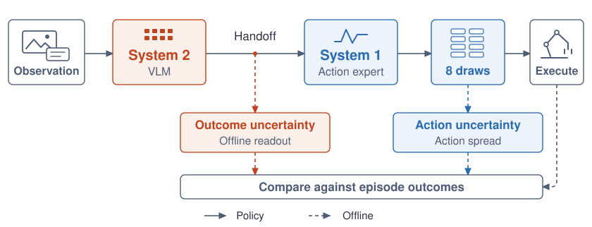

# VLA-Handoff

Code for *Outcome Uncertainty in Dual-System VLAs: Comparing Handoff Readouts and Action Spread*, by Yejin Jo and Minsu Jang.



The paper asks whether outcome uncertainty recoverable from a dual-system VLA's handoff is reflected in its sampled actions. At the same query of a frozen policy, we compare a supervised handoff readout with action spread, controlling for scene information, supervision, and sampling. Across five policies on LIBERO and SimplerEnv-Bridge, the handoff readout has an advantage in several settings, but the difference depends on the policy and evaluation setting. The analysis separates uncertainty accessible at the action expert's input from uncertainty expressed in its action samples; it does not establish why they differ.

## Getting started

1. Follow the [reproduction guide](docs/REPRODUCING.md) to install the CPU, simulator, and policy environments.
2. Review the [protocol settings](docs/PROTOCOLS.md) and select a cohort from the [collection grid](config/reproduction/cohorts.json).
3. Collect raw records, then run the analysis and table-generation commands in the guide.

To inspect the collection grid without starting a simulator or policy server:

```bash
python code/reproduce.py list
python code/reproduce.py collect spatial_confirm_gr00t --port 5662 --dry-run
```

Use Python 3.11 and [requirements.txt](requirements.txt) for CPU analysis. Model weights, simulators, and policy dependencies are installed separately; the guide records the corresponding source revisions and checkpoints.

## Repository contents

| Path | Contents |
|---|---|
| [code/](code/) | Collection clients, policy servers, analysis, replays, and table/figure generation |
| [config/reproduction/](config/reproduction/) | Checkpoint metadata and all 30 cohort configurations (10,752 episodes) |
| [assets/occluder/](assets/occluder/) | Fixed occluder inputs |
| [docs/REPRODUCING.md](docs/REPRODUCING.md) | Complete setup and reproduction commands |
| [docs/PROTOCOLS.md](docs/PROTOCOLS.md) | Statistical procedures, state conventions, and replay checks |

## Data and reproduction scope

Raw episode records, model weights, and saved experimental results are not included. Raw episode records are available from the authors upon request. Fresh collection runs may differ from the original trajectories; the guide distinguishes fresh replication from replay checks that require the original recorded inputs and runtime.

The historical single-trajectory DROID probes and earlier sampling-repeatability inputs cannot be regenerated from the fresh cohort grid alone. See the [ancillary experiments](docs/REPRODUCING.md#6-ancillary-experiments) and [protocol notes](docs/PROTOCOLS.md#ancillary-analyses) for their scope.

## License

Original code is licensed under [Apache 2.0](LICENSE). [NOTICE](NOTICE) includes third-party attribution and the license notice for the fixed LIBERO textures.
