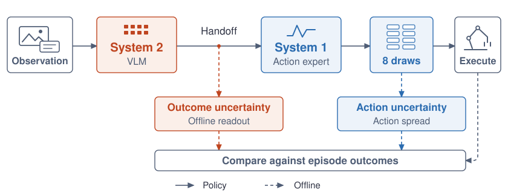

# VLA-Handoff

Code for *Outcome Uncertainty in Dual-System VLAs: Comparing Handoff Readouts and Action Spread*, by Yejin Jo and Minsu Jang.



We analyze how uncertainty relates across the two components of a dual-system VLA: outcome uncertainty recovered from the handoff representation and action uncertainty measured by sampled-action spread. The analysis separates uncertainty availability, accessibility along the conditioning path, and expression in actions. Both signals are measured at the same query of a frozen policy, with controls for scene information, readout supervision, and action sampling.

Across five policies on LIBERO and SimplerEnv-Bridge, the handoff readout exceeds action spread in several settings; other comparisons do not reach statistical significance. Measurements before and after GR00T's interface detect no average loss in readout accessibility. The direct intervention fails its positive control, so the cause of the gap remains unresolved.

The repository contains collection and analysis code, configuration, and fixed occluder inputs. Download model weights and simulators separately. Collect records locally before running analyses; saved experiment results are not required. Fresh runs may differ from the original trajectories.

[Setup](#setup) · [Collection](#1-select-and-collect-cohorts) · [Analysis](#2-primary-and-additional-occluder-analyses) · [Replays](#4-interface-and-handoff-intervention-replays) · [J64](#5-j64-sampling-follow-up) · [Additional experiments](#6-ancillary-experiments) · [Tables and figures](#7-generate-tables-and-figures)

## Setup

Use separate environments for CPU analysis, simulator clients, and policy servers. Run commands from this repository root and replace `/path/to/...` with local installations.

### CPU analysis

Use Linux and Python 3.11 for CPU analysis (the bootstrap uses `fork`). Cairo and Liberation Sans/Nimbus Sans fonts are needed for figures.

```bash
python3.11 -m venv .venv
source .venv/bin/activate
python -m pip install -r requirements.txt
```

### LIBERO client

Install [LIBERO](https://github.com/Lifelong-Robot-Learning/LIBERO) and its simulator dependencies following its instructions. Keep the supplied task BDDL and initialization files. Set:

```bash
export LIBERO_ROOT=/path/to/LIBERO
export LIBERO_PYTHON=/path/to/libero-environment/bin/python
python code/reproduce.py configure-libero "$LIBERO_ROOT"
export LIBERO_CONFIG_PATH="$PWD/config/local/libero"
export PYTHONPATH="$LIBERO_ROOT${PYTHONPATH:+:$PYTHONPATH}"
export MUJOCO_GL=egl
```

Keep the ten fixed occluder textures in `assets/occluder/`. `configure-libero` writes local paths to `config/local/libero/config.yaml`; set `MUJOCO_EGL_DEVICE_ID` if needed.

### Policy servers

Install each upstream project in its own environment. Recorded versions and checkpoint fingerprints are in `config/reproduction/<policy>.json`.

| Policy | Official source / checkpoint | Recorded environment | Executed steps |
|---|---|---|---:|
| GR00T-N1.7 LIBERO | [Isaac-GR00T](https://github.com/NVIDIA/Isaac-GR00T), [LIBERO checkpoints](https://huggingface.co/nvidia/GR00T-N1.7-LIBERO) | See `gr00t_spatial.json` and `gr00t_object.json` | 8 |
| GR00T-N1.7 Bridge | [Bridge checkpoint](https://huggingface.co/nvidia/GR00T-N1.7-SimplerEnv-Bridge), revision `940134b3c2948ccfdf8e7393f2d2ca869dc42833` | Python 3.12.13, torch 2.9.0+cu128, transformers 4.57.3 | 4 |
| MolmoAct2 | [MolmoAct2-LIBERO](https://huggingface.co/allenai/MolmoAct2-LIBERO) | Python 3.11.15, torch 2.5.1+cu124, transformers 5.3.0 | 10 |
| π0.5 | [OpenPI](https://github.com/Physical-Intelligence/openpi), `pi05_libero` PyTorch checkpoint | OpenPI `215abfb217dbac7d5f1273282331b9b1866c0479`, torch 2.7.1+cu126, NumPy 1.26.4 | 10 |
| SmolVLA | [lerobot/smolvla_libero](https://huggingface.co/lerobot/smolvla_libero), revision `a24f1f380461b665158d52acd140152c79e8b36d` | LeRobot 0.6.1, torch 2.11.0+cu130, transformers 5.5.4, NumPy 2.2.6 | 10 |
| τ0 low-level policy | [tau-0-vla](https://github.com/sii-research/tau-0-vla), official LIBERO checkpoint | source `d804047f7b2d61c45077daada3183703aeed8cf5`, Python 3.11, torch 2.7.1+cu128, transformers 5.5.4 | 8 |

For a fresh GR00T replication, use the unmodified official source at `376ba890cff8c9de64d71d982772a9c36185fdd7` (also recorded in `config/reproduction/gr00t_source.json`). The public servers attach measurement hooks directly; no model-source patch is required.

```bash
git clone https://github.com/NVIDIA/Isaac-GR00T.git /path/to/Isaac-GR00T
git -C /path/to/Isaac-GR00T checkout 376ba890cff8c9de64d71d982772a9c36185fdd7
```

Install GR00T at that revision using its upstream instructions. Keep one source/runtime for collection and replay. The official source is not certified as bitwise equivalent to the original local source; its GPU inference was not rerun during packaging.

Start only the server needed for the current cohort. The examples use `python` from that policy's environment and GPU 0; choose an available GPU and port locally.

```bash
# GR00T LIBERO: choose libero_spatial or libero_object to match the cohort.
export GR00T_ROOT=/path/to/Isaac-GR00T
export GR00T_MODEL_PATH=/path/to/GR00T-N1.7-LIBERO/libero_spatial
CUDA_VISIBLE_DEVICES=0 POLICY_SERVER_PORT=5662 POLICY_EXECUTE_STEPS=8 \
  python code/serve_icassp_gr00t.py

# GR00T Bridge: use the Bridge checkpoint and the SimplerEnv environment.
GR00T_MODEL_PATH=/path/to/GR00T-N1.7-SimplerEnv-Bridge \
CUDA_VISIBLE_DEVICES=0 POLICY_SERVER_PORT=5612 POLICY_EXECUTE_STEPS=4 \
  python code/serve_simpler_gr00t.py

# MolmoAct2 uses the checkpoint's local custom model code and normalizers.
MOLMO_MODEL_PATH=/path/to/MolmoAct2-LIBERO CUDA_VISIBLE_DEVICES=0 \
POLICY_SERVER_PORT=5670 python code/serve_icassp_molmo.py

# π0.5: convert/download the PyTorch checkpoint using OpenPI's instructions.
OPENPI_ROOT=/path/to/openpi PI05_CHECKPOINT=/path/to/pi05_libero_pytorch \
JAX_PLATFORMS=cpu CUDA_VISIBLE_DEVICES=0 POLICY_SERVER_PORT=5672 \
  python code/serve_icassp_pi05.py

# SmolVLA: cache HuggingFaceTB/SmolVLM2-500M-Video-Instruct beforehand.
SMOLVLA_CHECKPOINT=/path/to/smolvla_libero HF_HUB_OFFLINE=1 \
CUDA_VISIBLE_DEVICES=0 POLICY_SERVER_PORT=5910 POLICY_EXECUTE_STEPS=10 \
  python code/serve_icassp_smolvla.py

# τ0: install the upstream deployment environment, including its FLA dependency.
TAU0_ROOT=/path/to/tau-0-vla TAU0_CHECKPOINT=/path/to/tau-0-vla-libero \
CUDA_VISIBLE_DEVICES=0 POLICY_SERVER_PORT=5920 POLICY_EXECUTE_STEPS=8 \
  python code/serve_icassp_tau0.py
```

SmolVLA also needs `num2words==0.5.14` and `docopt==0.6.2`; τ0 used `flash-linear-attention==0.5.0`. Servers bind to localhost and record checkpoint/runtime metadata.

### SimplerEnv-Bridge client

Install the [SimplerEnv integration shipped with Isaac-GR00T](https://github.com/NVIDIA/Isaac-GR00T/tree/main/gr00t/eval/sim/SimplerEnv), including its simulator assets, in a separate environment. Set the source path and simulator interpreter, then use `--python "$SIMPLER_PYTHON"` for `bridge_reused` and `bridge_new`:

```bash
export GR00T_ROOT=/path/to/Isaac-GR00T
export SIMPLER_PYTHON=/path/to/simpler-environment/bin/python
```
Those cohorts use four canonical tasks, scenes 0–23, one camera, and 120-step episodes.

### Image-encoder controls

Use an environment with torch, torchvision, and transformers. Predownload `facebook/dinov2-base` revision `f9e44c814b77203eaa57a6bdbbd535f21ede1415` and torchvision ResNet-18 `IMAGENET1K_V1`. The extractor respects the Hugging Face cache configuration and `torch.hub.get_dir()` (including `TORCH_HOME`). It records weight checksums. It needs recorded input images, not fitted result summaries.

Recorded GPUs were A100 80 GB and RTX 6000 Ada. Replays require the same GPU model and runtime as their source collection.

## 1. Select and collect cohorts

Start the matching policy server above, then collect with the simulator interpreter. `--dry-run` prints commands; keep the default raw root (this checkout) for the table scripts, or symlink `data` to your output directory.

```bash
python code/reproduce.py list
python code/reproduce.py collect spatial_confirm_gr00t --python "$LIBERO_PYTHON" --port 5662
python code/reproduce.py collect bridge_new --python "$SIMPLER_PYTHON" --port 5612
```

The examples collect 600 LIBERO and 864 Bridge episodes. `config/reproduction/cohorts.json` specifies all 30 configurations (10,752 episodes).

| Cohort name pattern | Episodes | Collector / convention |
|---|---:|---|
| `{spatial,object}_main_{gr00t,pi05,molmoact}` | 3,600 | Original collector: clean, occluder, moved goal |
| `{spatial,object}_main2_{gr00t,pi05,molmoact}` | 1,200 | Original collector: retained lighting severity |
| `{spatial,object}_main3_{gr00t,pi05,molmoact}` | 1,200 | Original collector: retained relocated goal |
| `{spatial,object}_confirm_{gr00t,pi05}` | 2,400 | Corrected official axis-angle convention |
| `{spatial,object}_corrected_{molmoact,smolvla}` | 800 | Corrected official convention |
| `{spatial,object}_tau0_tau0` | 400 | Corrected official convention |
| `bridge_reused`, `bridge_new` | 288 + 864 | Bridge state convention; same protocol, separate seeds |

Main LIBERO cohorts use the preserved wrapped-axis-angle collector; follow-ups use the corrected official convention. `reproduce.py` selects the correct collector for each cohort. Do not exchange them.

For parallel collection, run all `--shard` indices with one common `--nshards` on matching servers. Resume only with an unchanged configuration.

Keep shard metadata, `summary.json`, `queries.jsonl`, and query NPZ files: later analyses need the recorded actions, handoffs, states, images, and seeds.

## 2. Primary and additional occluder analyses

Activate the CPU environment. Run only after all requested cohorts are complete.

```bash
export RAL_ROOT="$PWD" RAL_RAW_ROOT="$PWD"
# The primary family plus its raw-spread contrasts.
python code/spread_contrast.py 8 data/confirmatory/primary \
  gr00t_bridge_confirm,gr00t_spatial_confirm
# Supervision-matched spread control.
python code/learned_spread_contrast.py 8 data/learned_spread
python code/primary_predictions.py data/confirmatory/primary_predictions.json
```

`spread_contrast.py` defaults to the two primary cohorts when the third argument is omitted; to fit **all** additional cohorts, pass the full comma-separated cohort list from `ral_confirm_analysis.COHORTS`:

```bash
python code/spread_contrast.py 8 data/confirmatory/all \
  gr00t_bridge_confirm,gr00t_bridge_confirm_new,gr00t_spatial_confirm,gr00t_object_confirm,pi05_spatial_confirm,pi05_object_confirm,molmoact_spatial,molmoact_object,smolvla_spatial,smolvla_object,tau0_spatial,tau0_object
```

Outputs are `<directory>/confirm_results.json` with 2,000 full-refit bootstrap attempts.

Fit the DINOv2 control with a GPU environment that also has the analysis packages:

```bash
python code/ral_confirm_robustness.py --workers 8 --output data/confirmatory/image
```

This extracts DINOv2 features and runs the primary image controls and PCA/regularization sensitivities.

## 3. Original LIBERO conditions and scene-change decoding

Create within-condition views and the analysis folder:

```bash
python code/realistic_views.py
mkdir -p data/icassp2027/analysis paper/tables
```

Analyze all 24 suite–policy–condition combinations. Occluder/moved use `main`, lighting uses `main2`, and relocated uses `main3`:

```bash
for suite in spatial object; do
  for policy in gr00t pi05 molmoact; do
    for condition in occluder lighting moved relocated; do
      case "$condition" in
        lighting) campaign=main2 ;;
        relocated) campaign=main3 ;;
        *) campaign=main ;;
      esac
      python code/analyze_icassp_trials.py \
        --input "data/icassp2027/realistic_views/${suite}_${campaign}/${policy}/${condition}" \
        --output "data/icassp2027/analysis/realistic_${suite}_${condition}_${policy}.json" \
        --landmarks 40 80 || exit 1
    done
  done
done
python code/realistic_probe.py spatial
python code/realistic_probe.py object
python code/exp_20261020_e9_probe_null.py
```

For the generic image controls, run `python code/exp_20261020_e3_extract.py` in the GPU environment, then `python code/exp_20261020_e3_analysis.py` in the CPU environment.

Input-level uncertainty changes (T6) use:

```bash
python code/injection_input_level.py data/icassp2027/realistic data/injection/exp1_input_level.json
```

## 4. Interface and handoff intervention replays

These operate on the recorded primary-cohort inputs and outcomes. In the GR00T policy environment, set the source and matching checkpoint explicitly. For Bridge:

```bash
export GR00T_ROOT=/path/to/Isaac-GR00T
export GR00T_MODEL_PATH=/path/to/GR00T-N1.7-SimplerEnv-Bridge
PREPOST_MODE=bridge POLICY_SERVER_PORT=5952 CUDA_VISIBLE_DEVICES=0 python code/serve_prepost_gr00t.py
```

For Spatial, use `GR00T_MODEL_PATH=/path/to/GR00T-N1.7-LIBERO/libero_spatial` and `PREPOST_MODE=libero`. Start a server for each GPU model present in that cohort, and pass all their ports to the driver. Collect each primary cohort in the analysis environment:

```bash
python code/prepost_driver.py run data/prepost gr00t_bridge_confirm 5952
python code/prepost_driver.py collect data/prepost gr00t_bridge_confirm
# Repeat the two commands for gr00t_spatial_confirm with its LIBERO server.
python code/prepost_contrast.py 8 data/prepost data/prepost/main
```

Interface sensitivity commands appear in section 7. Start the direct-handoff server in the GR00T environment:

```bash
GR00T_ROOT=/path/to/Isaac-GR00T GR00T_MODEL_PATH=/path/to/GR00T-N1.7-SimplerEnv-Bridge \
POLICY_SERVER_PORT=5950 CUDA_VISIBLE_DEVICES=0 python code/serve_injection_gr00t.py
```

Pass ports for every recorded GPU model if the collection used multiple models. In the analysis environment, run:

```bash
python code/injection_handoff_driver.py directions data/injection/exp2_bridge
python code/injection_handoff_driver.py run data/injection/exp2_bridge 5950
python code/injection_handoff_analysis.py data/injection/exp2_bridge
```

Use fresh outputs and a GPU matching the collection. Replay parity and manipulation checks must pass; a failed positive control leaves the causal test inconclusive.

## 5. J64 sampling follow-up

J64 resamples active queries from completed cohorts while retaining their outcomes. Match the original checkpoint, runtime, and GPU model; drivers determine query counts from the new collection.

Start a sampling server in each matching policy environment. Keep the checkpoint, device model, and runtime used for the base collection:

```bash
# GR00T environment; repeat on another device/port if that cohort requires it.
GR00T_ROOT=/path/to/Isaac-GR00T GR00T_MODEL_PATH=/path/to/GR00T-N1.7-SimplerEnv-Bridge \
POLICY_SERVER_PORT=5980 POLICY_EXECUTE_STEPS=4 CUDA_VISIBLE_DEVICES=0 python code/serve_bridge_sampling.py

# SmolVLA environment.
SMOLVLA_CHECKPOINT=/path/to/smolvla_libero HF_HUB_OFFLINE=1 \
POLICY_SERVER_PORT=6000 POLICY_EXECUTE_STEPS=10 CUDA_VISIBLE_DEVICES=0 python code/serve_smol_sampling.py
```

In the CPU analysis environment, use new output directories and the ports of running compatible servers (one port suffices when the collection used one GPU model):

```bash
python code/bridge_sampling_replay.py prepare /path/to/new_bridge_replay
python code/bridge_sampling_replay.py run /path/to/new_bridge_replay 5980
python code/bridge_sampling_replay.py verify /path/to/new_bridge_replay
python code/bridge_sampling_analysis.py /path/to/new_bridge_replay --workers 8

python code/smol_sampling_replay.py prepare /path/to/new_smol_replay
python code/smol_sampling_analysis.py baseline /path/to/new_smol_replay
python code/smol_sampling_replay.py run /path/to/new_smol_replay 6000
python code/smol_sampling_replay.py verify /path/to/new_smol_replay
python code/smol_sampling_analysis.py analyze /path/to/new_smol_replay --workers 8
```

Analyses refit from raw records. `--reference-results` is optional for checking an external historical analysis; it is not needed for a fresh replication.

Replay drivers read `docs/PROTOCOLS.md` to bind runs to the analysis settings. Use an output directory outside `RAL_RAW_ROOT` for SmolVLA. Changing code/runtime requires a new prepared output directory.

```bash
python code/curate_sampling_results.py /path/to/new_bridge_replay /path/to/new_smol_replay data/sampling_summaries
```

## 6. Ancillary experiments

The following collections are additional to the 10,752-episode grid.

### Supplement S5 / Table S4: overlapping-chunk re-query experiment

The re-query experiment uses Spatial, π0.5/MolmoAct2, and three conditions (1,200 episodes). It samples eight 10-step plans and executes five steps per query, with a 280-step horizon. The E5 collector preserves the original wrapped-axis-angle convention.

Start the matching E5 server in its policy environment:

```bash
# π0.5 environment:
OPENPI_ROOT=/path/to/openpi PI05_CHECKPOINT=/path/to/pi05_libero_pytorch \
JAX_PLATFORMS=cpu CUDA_VISIBLE_DEVICES=0 POLICY_SERVER_PORT=5661 POLICY_SERVER_J=8 \
  python code/serve_icassp_pi05_e5.py

# MolmoAct2 environment:
MOLMO_MODEL_PATH=/path/to/MolmoAct2-LIBERO CUDA_VISIBLE_DEVICES=0 \
POLICY_SERVER_PORT=5660 POLICY_SERVER_J=8 \
  python code/serve_icassp_molmo_e5.py
```

Run both shards with the matching server active:

```bash
collect_requery() {
  local policy="$1" model="$2" port="$3" moved_severity="$4"
  local condition severity shard
  local -a wrist
  for condition in occluder moved relocated; do
    wrist=()
    case "$condition" in
      occluder) severity=1.0; wrist=(--apply-to-wrist) ;;
      moved) severity="$moved_severity" ;;
      relocated) severity=0.25 ;;
    esac
    for shard in 0 1; do
      "$LIBERO_PYTHON" code/icassp_rollout_e5.py \
        --out "data/icassp2027/realistic/requery_${condition}/${policy}" \
        --port "$port" --model "$model" --suite libero_spatial \
        --tasks 0,1,2,3,4,5,6,7,8,9 \
        --episodes 35,36,37,38,39,40,41,42,43,44,45,46,47,48,49,8,9,10,11,12 \
        --replicates 1 --conditions "$condition" --shard "$shard" --nshards 2 \
        --draws 8 --execute-steps 5 --max-steps 280 --onset 0 \
        --severity "$severity" --move-step 30 --move-duration 10 \
        --seed 20261011 "${wrist[@]}" || return 1
    done
  done
}
# Run each call while its matching E5 server is active:
collect_requery pi05 pi0.5 5661 0.20
collect_requery molmoact MolmoAct2 5660 0.15
```

After collecting all six cells, run the CPU analyzer for handoff and temporal-consistency readouts:

```bash
for policy in pi05 molmoact; do
  for condition in occluder moved relocated; do
    python code/analyze_icassp_e5.py \
      --input "data/icassp2027/realistic/requery_${condition}/${policy}" \
      --output "data/icassp2027/analysis/realistic_requery_${condition}_${policy}.json" \
      --landmarks 40 80 || exit 1
  done
done
python code/gen_realistic_tables.py --tables requery_realistic
cp paper/tables/requery_realistic.tex paper/tables/supp_requery.tex
```

### Supplement S6: paired view restoration

First collect and analyze the six `{spatial,object}_main_{pi05,gr00t,molmoact}` cohorts. Their source prefixes require `--state-convention recorded`; use `official` only for prefixes actually collected with the corrected convention.

Use the corresponding standard server above, with the same checkpoint, runtime, and GPU model. GR00T needs the matching Spatial/Object checkpoint and eight executed steps; π0.5/MolmoAct2 use ten.

```bash
collect_restoration() {
  local suite="$1" policy="$2" model="$3" port="$4"
  "$LIBERO_PYTHON" code/exp_20261029_view_restore.py \
    --source "data/icassp2027/realistic/${suite}_main/${policy}" \
    --out "data/icassp2027/exp_20261029/${suite}/${policy}" \
    --port "$port" --model "$model" --shard 0 --nshards 1 \
    --state-convention recorded
}
# Invoke each line with its matching server active:
collect_restoration spatial pi05 pi0.5 5672
collect_restoration spatial gr00t GR00T 5662
collect_restoration spatial molmoact MolmoAct2 5670
collect_restoration object pi05 pi0.5 5672
# Restart the GR00T server with the Object checkpoint before this call:
collect_restoration object gr00t GR00T 5662
collect_restoration object molmoact MolmoAct2 5670
```

Restoration collects both continue/restore branches for every source occluder episode active beyond step 80. Keep one common shard count; do not use `--replay-only` in the same output directory.

Branches replay through the chunk queried at step 80, then sample J=1 through the 280-step horizon using the source seeds. Simulator coordinate error above `1e-5` is a replay mismatch. J=8 source actions and J=1 continuations need not match despite equal seeds.

In the CPU environment, analyze and render:

```bash
python code/exp_20261029_view_restore_analysis.py --suites spatial,object \
  --output data/view_restore/view_restore_analysis.json --no-table
python - <<'PY' || exit 1
import json
from pathlib import Path
p = Path('data/view_restore/view_restore_analysis.json')
r = json.loads(p.read_text())
expected = {f'{s}|{p}' for s in ('spatial', 'object')
            for p in ('pi05', 'gr00t', 'molmoact')}
if set(r['cells']) != expected:
    raise SystemExit('Missing restoration cells; inspect branch records and eligible folds.')
for key, c in r['cells'].items():
    print(key, {k: c[k] for k in ('n', 'active_at_80', 'complete',
        'max_replay_error', 'continue_matches_source', 'first_action_matches_source')})
    if not c['complete'] or c['max_replay_error'] > 1e-5:
        raise SystemExit('Incomplete restoration analysis; inspect recorded mismatches and missing prefixes.')
PY
python code/make_view_restore_table.py \
  data/view_restore/view_restore_analysis.json paper/tables/supp_view_restore.tex
```

Inspect replay, image, and action parity fields. Missing calibrated alarms are unevaluable gates, not zero interventions.

The random comparator matches each task's realized intervention rate. Analysis averages policies within suite–task clusters, then clusters equally, with 10,000 cluster-bootstrap draws and Holm correction over four gates.

The earlier DROID probe and independent-seed repeatability study need historical inputs not included here; the fresh cohort grid does not regenerate them.

## 7. Generate tables and figures

Run after the corresponding analyses. Tables and figures read newly generated estimates; missing inputs stop generation.

```bash
mkdir -p paper/tables paper/figures

# Original-campaign tables, including the probe table consumed by Figure 4.
python code/gen_realistic_tables.py

# Main Tables 2, 3, 5 and detailed image-control export (TeX and CSV).
# The image export needs the completed image extraction and E3 analysis from section 3.
python code/make_current_tables.py \
  --confirm-results data/confirmatory/all/confirm_results.json --output paper/tables

# Main Table 4, after the input-level analysis in section 3.
python code/make_injection_table.py data/injection/exp1_input_level.json paper/tables/input_injection.tex

# Detailed confirmatory, image-control and policy exports for Supplement Tables S2–S3.
python code/make_supp_confirm_tables.py data/confirmatory paper/tables \
  --confirm-results data/confirmatory/all/confirm_results.json \
  --robustness-results data/confirmatory/image/robustness_results.json \
  --policy-results data/confirmatory/all/confirm_results.json \
  --spread-results data/confirmatory/all/confirm_results.json

# Detailed spread/interface exports supporting the text in Supplement Section S3.
python code/make_learned_spread_table.py data/learned_spread/confirm_results.json paper/tables
python code/make_prepost_table.py data/prepost/main/confirm_results.json paper/tables

# Figures 3 and 4. Figure 3 uses a stored clean Spatial task-3 input frame.
python code/plot_perturbation_examples.py data
python code/plot_figures.py data/confirmatory/all/confirm_results.json \
  data/confirmatory/primary_predictions.json paper/figures paper/tables/probe_realistic.tex

# Detailed J/seed exports, after the J64 analysis and curation in section 5.
python code/make_sampling_tables.py data/sampling_summaries paper/tables
```

`make_current_tables.py` writes TeX/CSV exports. `--tables main2 main3 main5` or `--tables supp2` selects a subset; `--episodes-root` changes the original-cohort input location.

For the interface sensitivity results summarized in Supplement Section S3, run all four predefined settings and pass every result to the formatter:

```bash
PREPOST_PCA=10 python code/prepost_contrast.py 8 data/prepost data/prepost/pca10
PREPOST_PCA=50 python code/prepost_contrast.py 8 data/prepost data/prepost/pca50
PREPOST_C=0.1 python code/prepost_contrast.py 8 data/prepost data/prepost/c0p1
PREPOST_C=10 python code/prepost_contrast.py 8 data/prepost data/prepost/c10
python code/make_prepost_table.py data/prepost/main/confirm_results.json paper/tables \
  'PCA 10=data/prepost/pca10/confirm_results.json' 'PCA 50=data/prepost/pca50/confirm_results.json' \
  'C 0.1=data/prepost/c0p1/confirm_results.json' 'C 10=data/prepost/c10/confirm_results.json'
```

Generate the intervention and compact supplement tables after the detailed exports:

```bash
python code/make_handoff_injection_table.py \
  data/injection/exp2_bridge/analysis.json paper/tables/supp_handoff_injection.tex
python code/make_compact_supp_tables.py paper/tables paper/tables
```

| Supplement table | Generated file | Content |
| --- | --- | --- |
| S1 | `supp_goal_summary.tex` | Both goal perturbations, all policies and suites |
| S2 | `supp_confirm_summary.tex` | GR00T scene and image controls, all landmarks |
| S3 | `supp_policy_summary.tex` | Policy contrasts at both landmarks |
| S4 | `supp_requery_summary.tex` | Step-80 temporal consistency, all six cells |
| S5 | `supp_handoff_injection.tex` | All intervention directions and scales |
| S6 | `supp_sampling_summary.tex` | All J64 contrasts and both seed streams |

## License

Original code is licensed under [Apache 2.0](LICENSE). [NOTICE](NOTICE) includes third-party attribution and the license notice for the fixed LIBERO textures. [Protocol settings](docs/PROTOCOLS.md) are also read by the replay drivers.
